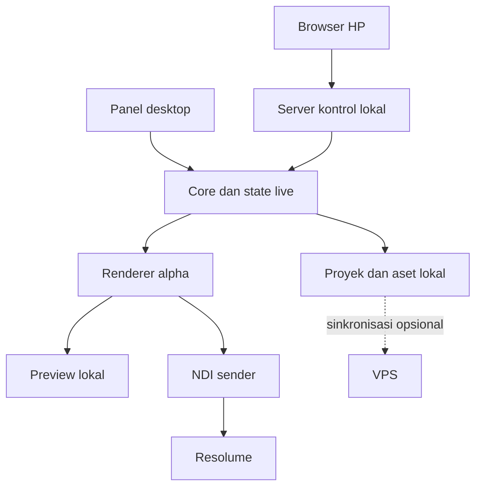
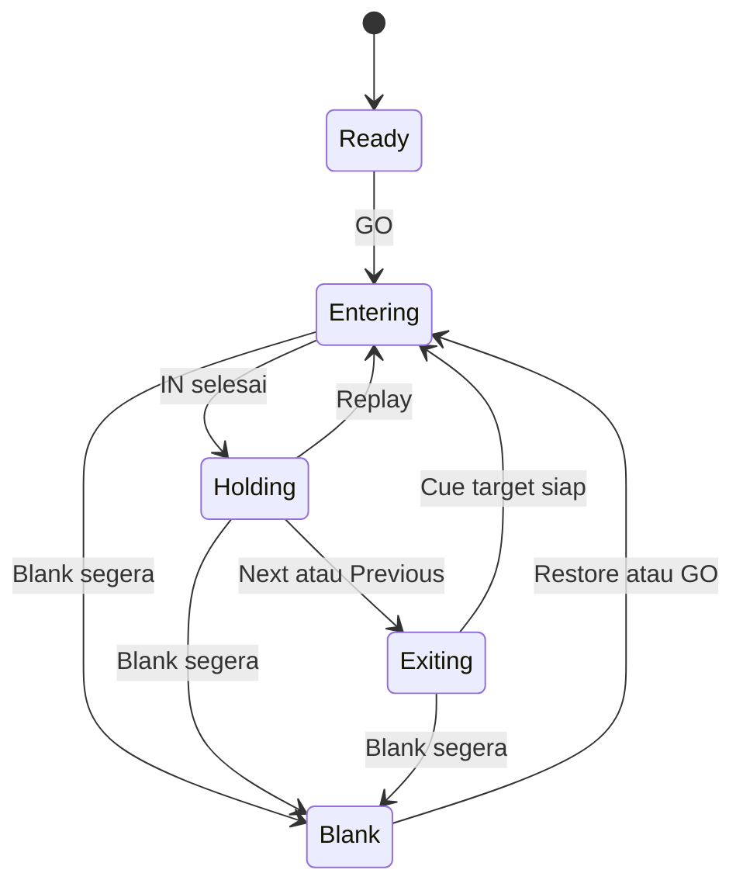

# LuiLyric
## Spesifikasi produk dan panduan pengembangan

Versi dokumen: 1.1  
Tanggal: 16 Oktober 2026  
Bahasa antarmuka utama: Indonesia  
Status: rancangan pengembangan, bukan aplikasi yang sudah selesai  
Nama aplikasi: LuiLyric. Identitas visual mengacu pada https://luifierey.my.id/.

## 1. Ringkasan produk

LuiLyric adalah aplikasi untuk menampilkan satu baris lirik dalam satu tampilan dengan animasi tipografi yang dapat diatur. Operator mengganti baris secara manual mengikuti penyanyi atau musik. Aplikasi mengirim hasil render dengan latar transparan ke Resolume melalui NDI dengan alpha channel.

Aplikasi utama berjalan di laptop Windows yang sama dengan Resolume. Operator dapat mengendalikan aplikasi dari laptop atau browser HP pada jaringan lokal. VPS bersifat opsional untuk cadangan, sinkronisasi, dan kontrol jarak jauh pada tahap lanjutan.

Dokumen ini menjadi acuan untuk developer atau agen coding. Semua fitur yang belum dibangun adalah persyaratan atau target. Dukungan protokol tidak berarti integrasi aplikasi sudah terbukti bekerja.

## 2. Kebutuhan yang sudah disepakati

| ID | Kebutuhan | Status |
| --- | --- | --- |
| REQ-01 | Satu baris lirik per tampilan | Wajib |
| REQ-02 | Next dan Previous manual | Wajib |
| REQ-03 | Animasi teks bervariasi | Wajib |
| REQ-04 | Font dan style dapat diatur | Wajib |
| REQ-05 | Output hanya animasi lirik, tanpa UI | Wajib |
| REQ-06 | Output NDI dengan alpha ke Resolume | Wajib |
| REQ-07 | Laptop yang sama menjalankan aplikasi dan Resolume | Skenario utama |
| REQ-08 | Distribusi aplikasi Windows melalui installer .exe | Target |
| REQ-09 | Kontrol HP melalui browser | Wajib pada versi operasional |
| REQ-10 | VPS tidak wajib saat live | Keputusan rancangan |

Spout dapat ditambahkan sebagai output alternatif untuk satu komputer Windows. Spout tidak menggantikan kewajiban output NDI alpha tanpa persetujuan perubahan scope.

## 3. Tujuan dan batas produk

### Tujuan

- Menyiapkan lirik satu lagu tanpa membuat video terpisah untuk setiap baris.
- Menyesuaikan pergantian lirik secara langsung ketika penyanyi mengulang chorus atau mengubah tempo.
- Menyimpan tampilan visual yang berbeda untuk setiap baris.
- Menumpuk lirik di atas visual Resolume tanpa chroma key.
- Tetap berfungsi tanpa internet setelah pemasangan dan persiapan aset lokal.

### Di luar versi awal

- Pengenalan suara dan sinkronisasi otomatis dengan penyanyi.
- Pengunduhan otomatis semua lirik lagu dari internet.
- Timeline video lengkap seperti aplikasi editing profesional.
- Rendering video di VPS sebagai jalur utama live.
- Dukungan macOS, MIDI, OSC, timecode, dan audio-reactive pada rilis pertama.
- Jaminan 4K 60 fps pada perangkat yang belum diuji.

## 4. Alur penggunaan

### Persiapan lagu

1. Operator membuat proyek dan menambahkan judul lagu serta artis opsional.
2. Operator menempelkan lirik atau mengimpor file UTF-8 .txt.
3. Setiap newline menjadi satu cue. Baris kosong menjadi pemisah bagian, bukan otomatis cue kosong.
4. Operator memeriksa hasil pemisahan sebelum menyimpan.
5. Operator menerapkan preset dasar untuk satu lagu.
6. Operator memberi override font, style, atau animasi pada baris tertentu.
7. Operator mencoba preview dan menyimpan proyek.

### Saat live

1. Buka aplikasi, pilih proyek dan lagu.
2. Aktifkan output NDI. Status awal output transparan penuh.
3. Pilih sumber NDI aplikasi pada panel Sources Resolume, lalu tempatkan pada layer di atas visual.
4. Pastikan alpha diterima dengan pengujian background kontras.
5. Tekan GO untuk cue awal. Next berpindah ke cue berikutnya.
6. Teks menjalankan animasi masuk, kemudian diam atau looping sampai perintah berikutnya.
7. Blank menyembunyikan lirik. Output tetap tersedia dan mengirim frame transparan.
8. Di akhir lagu, aplikasi tidak otomatis berpindah ke lagu selanjutnya.

### Kontrol HP

1. Laptop dan HP memakai jaringan lokal yang sama, misalnya router pribadi atau hotspot.
2. Operator mengaktifkan Remote Control pada aplikasi laptop.
3. Aplikasi menampilkan alamat lokal dan QR pairing.
4. HP membuka panel dan memasukkan kode pairing bila diperlukan.
5. Laptop menyetujui sesi pertama. HP menampilkan status koneksi serta cue aktif.
6. Jika koneksi terputus, output laptop tetap berjalan. HP tidak mengantre perintah untuk dikirim nanti.

## 5. Model cue dan pemisahan lirik

Satu cue berisi satu baris teks. Baris panjang tidak boleh diam-diam berubah menjadi beberapa baris pada output. Pilihan default adalah mengecilkan font sampai batas minimum. Jika masih tidak muat, tampilkan peringatan di editor dan minta operator membagi cue atau memilih pengaturan yang sesuai.

- Pertahankan tanda baca, aksen, dan karakter Unicode.
- Normalisasi CRLF dan LF saat impor.
- Judul bagian seperti [Verse], [Chorus], atau [Bridge] menjadi metadata jika operator memilih opsi tersebut.
- Tawarkan pengaturan perlakuan baris kosong dalam dialog impor.
- Berikan ID cue stabil, tidak bergantung pada nomor urut.
- Mendukung tambah, edit, duplikasi, hapus, dan susun ulang cue.
- Cue kosong untuk jeda instrumental harus dibuat secara eksplisit.
- Pemilihan cue dalam editor hanya mengubah preview. GO mengirimnya ke output live.
- Jump langsung saat live tersedia melalui tindakan terpisah yang jelas.

## 6. Antarmuka laptop

Gunakan tema gelap, kontras tinggi, dan tombol live yang mudah ditemukan. Hindari dekorasi bergerak pada panel kontrol yang dapat mengganggu operator.

| Area | Isi |
| --- | --- |
| Sidebar kiri | Proyek, setlist, lagu, pencarian |
| Panel cue | Nomor, teks, bagian lagu, nama preset, penanda selected dan live |
| Preview | Checkerboard transparansi, safe area opsional, preview animasi |
| Live monitor | Hasil cue yang sedang ditayangkan, label LIVE |
| Inspector kanan | Font, ukuran, posisi, warna, outline, glow, animasi |
| Transport bawah | GO, Previous, Next, Replay, Blank, Restore |
| Status | NDI, koneksi HP, FPS, dropped frames, proyek tersimpan |

Preview harus terpisah dari live. Mengubah font di editor tidak langsung merusak cue yang sedang tayang. Sediakan tombol Apply to Live yang eksplisit jika operator ingin menerapkan perubahan saat itu juga.

### Shortcut default yang diusulkan

| Shortcut | Fungsi |
| --- | --- |
| Right atau PageDown | Cue berikutnya |
| Left atau PageUp | Cue sebelumnya |
| Enter | GO pada cue terpilih |
| R | Ulangi animasi cue live |
| B | Blank |
| Shift+B | Restore cue live |
| Ctrl+S | Simpan proyek |

Shortcut transport tidak aktif saat fokus berada pada input teks. Shortcut global lintas aplikasi harus opt-in, dapat dikonfigurasi, dan tidak boleh mengambil alih shortcut Resolume tanpa pemberitahuan.

## 7. Antarmuka HP

Panel HP berfokus pada kontrol pertunjukan. Editor lengkap tetap tersedia di laptop.

- Tombol Next paling besar dan mudah dijangkau ibu jari.
- Tampilkan baris aktif dan baris berikutnya.
- Tombol Previous, Blank, Restore, dan Replay tersedia tanpa membuka submenu.
- Daftar cue memungkinkan pemilihan dan GO, dengan pembeda jelas antara preview dan live.
- Tampilkan nama lagu, nomor cue, koneksi, dan konfirmasi perintah.
- Status tidak hanya memakai warna; gunakan teks Connected, Reconnecting, atau Disconnected.
- Tombol live nonaktif saat koneksi terputus.
- Mendukung portrait dan landscape.
- Haptic feedback bersifat opsional jika browser mendukung.
- Pencegahan layar tidur bersifat opsional. Kegagalan izin browser tidak memblokir kontrol.
- Preview video di HP bukan syarat MVP. Tampilan teks status lebih ringan.

## 8. Font, style, dan layout

### Typography

- Pilihan font yang terpasang di Windows dan impor .ttf/.otf yang valid.
- Ukuran, weight, italic, kapitalisasi, letter spacing, dan opacity.
- Kontrol posisi X/Y relatif terhadap kanvas serta anchor kiri, tengah, atau kanan.
- Font lokal digunakan untuk mode offline; tidak mengunduh Google Fonts ketika pertunjukan sedang berjalan.
- Validasi karakter yang tidak tersedia pada font dan tampilkan fallback secara jelas.
- Font custom yang disertakan dalam ekspor mengikuti hak distribusi pemilik font.

### Style visual

- Warna solid dan gradasi.
- Outline dengan warna serta ketebalan.
- Shadow dengan offset, blur, dan opacity.
- Glow dengan warna, radius, dan intensitas.
- Mode fill, outline-only, atau fill + outline.
- Background output default transparan penuh.
- Checkerboard hanya untuk preview, tidak masuk ke NDI.
- Elemen dekoratif tambahan, jika kelak tersedia, menjadi bagian cue dan harus bisa dimatikan.

### Pewarisan style

Urutan resolusi: default aplikasi, preset lagu, preset cue, lalu override cue. Simpan referensi preset beserta versi atau snapshot agar perubahan preset tidak mengubah proyek lama secara diam-diam. Reset override mengembalikan nilai warisan, bukan menghapus cue.

## 9. Sistem animasi

Setiap cue memiliki fase IN, HOLD, dan OUT.

| Fase | Perilaku |
| --- | --- |
| IN | Dipicu sekali saat cue mulai tayang |
| HOLD | Teks bertahan atau looping tanpa batas sampai ada perintah |
| OUT | Dipicu saat cue diganti atau disembunyikan secara halus |

### Preset animasi yang direncanakan

| Kelompok | Contoh | Prioritas |
| --- | --- | --- |
| Masuk dasar | Fade, Slide Up, Slide Left, Zoom | MVP |
| Masuk bertahap | Word Reveal, Character Reveal | MVP setelah render dasar stabil |
| Masuk lanjutan | Blur Reveal, Flip, Tracking Expand | V1 |
| Hold | Static, Gentle Float, Pulse, Glow Breath | MVP |
| Hold lanjutan | Wave per karakter, RGB Split, Glitch terkontrol | V1 |
| Keluar | Fade, Slide, Shrink, Cut | MVP |

Daftar ini adalah scope pengembangan, bukan klaim fitur yang sudah tersedia.

### Parameter

- Durasi masuk dan keluar dalam milidetik.
- Easing dari daftar terbatas yang teruji.
- Delay awal dan stagger per kata atau karakter.
- Arah dan jarak gerak.
- Besar skala, rotasi, blur, dan amplitudo loop sesuai preset.
- Kecepatan loop terpisah dari durasi masuk.
- Seed tersimpan jika memakai variasi acak agar replay konsisten.
- Preview dan output memakai definisi animasi yang sama.

### Kebijakan pergantian

Mode default strict-single: cue lama selesai OUT, kemudian cue baru masuk. Ini menjaga satu baris terlihat pada satu waktu. Mode Cut dapat langsung mengganti cue. Crossfade dua cue menjadi fitur opsional karena menampilkan dua baris bersamaan selama transisi.

Saat Next ditekan cepat, engine memakai target cue terbaru dan membatalkan pekerjaan transisi yang sudah usang. Jangan menumpuk antrean animasi panjang. Satu gesture menghasilkan satu command; pengiriman ulang command dengan ID sama tidak boleh memicu Next kedua kali.

Replay mengulang animasi cue aktif tanpa mengubah indeks. Blank memiliki mode cut segera dan fade opsional. Restore memulai kembali IN cue yang disembunyikan.

## 10. Output NDI dengan alpha

### Persyaratan inti

1. Render dilakukan pada surface offscreen dengan kanal warna dan alpha.
2. Area tanpa teks mempunyai alpha 0.
3. Teks dan efek transparan mempertahankan nilai alpha parsial.
4. Kirim frame melalui NDI SDK menggunakan format yang mendukung alpha, misalnya BGRA.
5. Konversi premultiplied dan straight alpha dilakukan sesuai kontrak renderer, SDK, dan receiver yang dipilih. Jangan menebak konvensinya.
6. Output tidak berasal dari screenshot desktop atau window capture yang menghilangkan alpha.
7. Sender tetap hidup saat Blank dengan frame transparan, bukan hilang dari daftar Sources.

Dokumentasi NDI menjelaskan format frame dengan alpha. Resolume mendokumentasikan dukungan NDI termasuk alpha. Integrasi end-to-end tetap wajib diuji pada versi yang dipasang.

### Pengaturan output

| Pengaturan | Default usulan |
| --- | --- |
| Nama sender | LuiLyric - Main |
| Resolusi awal | 1920 × 1080 |
| Frame rate awal | 30 fps |
| Pilihan tambahan | 1280 × 720, 60 fps setelah benchmark |
| Alpha | Aktif |
| Audio | Tidak dikirim |
| Saat aplikasi dibuka | Output belum aktif dan cue belum tayang |
| Saat Blank | Sender aktif, seluruh frame transparan |

60 fps adalah target opsional yang bergantung pada hardware. Ukuran custom dibatasi agar tidak menyebabkan alokasi memori ekstrem. Perubahan resolusi ketika live memerlukan penerapan eksplisit dan reinitialisasi sender yang terkendali.

Status harus membedakan SDK tersedia, sender dibuat, frame berhasil diserahkan, dan receiver terdeteksi jika API menyediakan informasi tersebut. Jangan menampilkan klaim Connected to Resolume hanya karena sender aktif. Validasi visual dilakukan di Resolume.

### Alternatif Spout

Tambahkan adapter Spout pada tahap lanjutan untuk pengiriman lokal Windows. Gunakan render surface yang sama sejauh memungkinkan. NDI dan Spout tidak aktif bersamaan secara default sampai biaya performanya diukur. Tangani perbedaan GPU pada laptop hybrid dan uji kedua aplikasi pada GPU yang sesuai.

## 11. Arsitektur yang diusulkan

Keputusan stack final harus mengikuti proof of concept output NDI alpha. Pada tahap desktop native, prioritaskan keberhasilan output sebelum memperluas editor. Tahap web awal hanya membangun bagian portabel dan tidak menetapkan pipeline native sebagai keputusan final.



### Kandidat implementasi

| Komponen | Pilihan awal untuk dievaluasi |
| --- | --- |
| Desktop UI | React + TypeScript dalam Electron |
| State dan server lokal | TypeScript, HTTP lokal dan WebSocket |
| Renderer | Offscreen canvas/WebGL atau renderer native yang diuji |
| Native output | Modul C++ atau sidecar yang mengintegrasikan NDI SDK |
| Penyimpanan | SQLite untuk katalog, berkas proyek dan aset lokal |
| Packaging | Installer Windows .exe melalui tool packaging yang sesuai |
| VPS opsional | API HTTPS dan penyimpanan proyek dengan autentikasi |

Electron merupakan kandidat, bukan keputusan yang sudah dibenchmark. Jika jalur frame offscreen ke native terlalu mahal, evaluasi renderer native C++/Qt dengan kontrol web lokal. Jangan memilih paket NDI pihak ketiga hanya karena namanya cocok. Verifikasi pemeliharaan, platform, alpha, lisensi, dan pengujian paket tersebut terlebih dahulu.

### Batas proses

- UI tidak menjalankan encoding NDI pada thread interaksi.
- Native sender diisolasi jika memungkinkan agar kegagalannya tidak menutup editor.
- Gunakan ring buffer terbatas untuk frame, misalnya dua atau tiga slot.
- Jika sender tertinggal, buang frame lama dan proses yang terbaru. Jangan menambah latency lewat antrean tanpa batas.
- Dokumentasikan ownership buffer. Buffer tidak boleh digunakan ulang sebelum SDK selesai memakainya.
- Ukur biaya readback GPU, copy buffer, konversi warna, dan encoding secara terpisah.
- Renderer memakai monotonic clock, bukan interval UI sebagai sumber waktu utama.
- Output tetap berjalan saat jendela diminimalkan. Ini harus diuji khusus, bukan diasumsikan.

## 12. State machine live

Pisahkan state editor dari state output: selectedCueId tidak sama dengan liveCueId.



Diagram memperlihatkan jalur utama. Implementasi juga wajib menangani perintah baru selama Entering/Exiting berdasarkan target cue terbaru. Previous pada cue pertama dan Next pada cue terakhir menjadi no-op dengan feedback. Jangan wrap ke awal tanpa opsi eksplisit.

Jika cue dihapus saat live, engine mempertahankan snapshot cue yang sedang ditampilkan sampai operator memberi command berikutnya. Aktivasi lagu baru dimulai dalam keadaan blank agar tidak menayangkan baris pertama tanpa sengaja.

## 13. Model data proyek

Contoh berikut adalah kontrak awal, bukan format final yang sudah diimplementasikan.

```json
{
  "schemaVersion": 1,
  "projectId": "project-demo",
  "name": "Setlist Live",
  "output": { "width": 1920, "height": 1080, "fps": 30, "alpha": true },
  "songs": [
    {
      "id": "song-001",
      "title": "Lagu Contoh",
      "defaultPresetId": "preset-clean",
      "cues": [
        {
          "id": "cue-001",
          "text": "Ini contoh baris pertama",
          "section": "Verse 1",
          "presetId": "preset-clean",
          "styleOverrides": { "fill": "#FFFFFF", "fontSize": 100 },
          "animation": {
            "in": { "type": "wordReveal", "durationMs": 600, "staggerMs": 60 },
            "hold": { "type": "static" },
            "out": { "type": "fade", "durationMs": 180 }
          }
        }
      ]
    }
  ],
  "presets": [
    {
      "id": "preset-clean",
      "version": 1,
      "style": {
        "fontFamily": "Arial",
        "fontWeight": 700,
        "fontSize": 100,
        "fill": "#FFFFFF",
        "x": 0.5,
        "y": 0.5,
        "anchor": "center",
        "opacity": 1
      }
    }
  ]
}
```

- Font size diukur dalam piksel pada resolusi desain. Definisikan scaling ketika output berubah.
- X/Y merupakan koordinat ternormalisasi 0 sampai 1.
- Validasi enum, rentang angka, panjang teks, jumlah cue, dan referensi preset.
- Sertakan timestamp, versi aplikasi, metadata aset, dan checksum pada format produksi.
- Jangan menyimpan token pairing atau kredensial VPS dalam proyek ekspor.
- Migrasi schema harus membuat backup sebelum mengubah proyek lama.

## 14. Kontrak kontrol lokal

Contoh rute yang diusulkan:

| Metode/rute | Fungsi |
| --- | --- |
| GET /remote | Panel HP |
| POST /api/pair | Pairing menggunakan kode sekali pakai |
| GET /api/state | Snapshot state setelah autentikasi |
| WS /ws/control | Command, acknowledgement, dan update state |
| POST /api/session/revoke | Cabut sesi perangkat |

Contoh command:

```json
{
  "type": "command",
  "id": "command-unique-001",
  "sessionId": "paired-session",
  "expectedRevision": 42,
  "action": "NEXT",
  "payload": {}
}
```

Contoh acknowledgement:

```json
{
  "type": "ack",
  "commandId": "command-unique-001",
  "accepted": true,
  "revision": 43,
  "liveCueId": "cue-002"
}
```

Action awal: GO_CUE, NEXT, PREVIOUS, REPLAY, BLANK, RESTORE, SELECT_SONG. Editing proyek melalui HP dapat ditunda.

Core adalah otoritas tunggal. Command diproses berurutan. ID command digunakan untuk deduplikasi dalam jendela waktu terbatas. expectedRevision yang usang ditolak disertai snapshot terbaru. Klien boleh membuffer input singkat hanya ketika koneksi aktif dan menunggu ack; perintah tersebut harus dibuang ketika disconnect. Tidak ada replay perintah lama setelah reconnect.

Gunakan heartbeat dan indikator timeout. Mode default hanya satu remote controller aktif; desktop tetap dapat mengambil alih dan mencabut sesi HP. Port lokal dapat dikonfigurasi dan harus diperiksa bentroknya.

## 15. Keamanan kontrol

- Remote server mati sampai pengguna mengaktifkannya.
- Pairing memerlukan kode berumur pendek dan pembatasan percobaan.
- Setelah pairing, gunakan token sesi acak yang cukup kuat dan jangan mencatatnya di log.
- Validasi Origin/Host dan cegah koneksi WebSocket lintas situs yang tidak berwenang.
- Terapkan batas ukuran payload dan rate limit.
- Jangan menyediakan endpoint shell atau akses file sembarang.
- Batasi akses file pada direktori proyek/aset yang diizinkan.
- Untuk HTTP lokal, jelaskan bahwa lalu lintas tidak terenkripsi dan gunakan jaringan tepercaya. HTTPS lokal dapat menjadi opsi lanjutan.
- Jangan melakukan port forwarding panel kontrol langsung ke internet.
- Mode internet kelak harus memakai HTTPS/WSS, autentikasi, otorisasi proyek, dan pencabutan perangkat.

## 16. Penyimpanan dan pemulihan

- Simpan data pengguna pada direktori aplikasi pengguna Windows, bukan direktori instalasi.
- Autosave editor dengan debounce dan indikator perubahan belum tersimpan.
- Gunakan penulisan atomik atau transaksi database.
- Buat backup bergilir dan tombol Restore Backup.
- Ekspor proyek sebagai arsip berisi manifest, lagu, preset, dan aset yang boleh disertakan.
- Lindungi impor arsip dari path traversal dan ukuran ekstraksi berlebihan.
- Saat crash, tawarkan pemulihan proyek terakhir. Jangan otomatis menayangkan cue ketika restart.
- Snapshot live dipisahkan dari perubahan draft sehingga autosave tidak mengubah output.
- Setlist harus mempertahankan urutan lagu yang disimpan operator.

## 17. Peran VPS

VPS tidak masuk jalur render maupun transport NDI lokal. Versi awal tetap bekerja jika VPS mati.

Tahap lanjutan dapat menyediakan login, backup proyek, sinkronisasi preset, dan akses koleksi lagu. Konflik versi diselesaikan dengan membuat salinan atau meminta pilihan pengguna; jangan menimpa proyek live.

Kontrol internet menggunakan relay pesan yang diautentikasi atau koneksi privat yang sesuai. Laptop memulai koneksi keluar ke relay. NDI video tidak dikirim melalui VPS secara default. Saat relay putus, kontrol lokal tetap tersedia.

Cloud sync ditunda atau dimatikan selama Live Mode untuk menghindari perubahan proyek dan transfer besar di tengah pertunjukan.

## 18. Performa dan observabilitas

Semua angka berikut merupakan target pengujian awal, bukan jaminan hardware.

| Metrik | Target awal |
| --- | --- |
| Render dasar | 1080p 30 fps pada laptop target |
| Durasi uji stabilitas | Minimal 2 jam bersama Resolume |
| Waktu command lokal ke awal perubahan renderer | p95 di bawah 100 ms pada jaringan uji yang dicatat |
| Frame terlambat | Di bawah 1% selama skenario uji yang disepakati |
| Antrean frame | Terbatas, tidak bertambah selama uji |
| Memori | Tidak menunjukkan pertumbuhan berkelanjutan setelah warm-up |

Ukur command latency terpisah dari durasi OUT/IN dan latency display Resolume. Catat CPU, GPU, RAM, versi Windows, driver, versi Resolume, NDI runtime, resolusi, dan efek yang digunakan. Target 60 fps ditentukan setelah benchmark, bukan sekadar pilihan dropdown.

Log mencakup start/stop output, pergantian cue, error sender, remote disconnect, dan kegagalan save. Isi lirik tidak perlu dicatat secara default. Jangan mencatat token, kode pairing, atau kredensial.

## 19. Penanganan kegagalan

| Kondisi | Perilaku wajib |
| --- | --- |
| HP putus koneksi | Output bertahan; kontrol laptop berfungsi |
| Internet/VPS mati | Operasi live lokal tidak terpengaruh |
| NDI SDK/runtime tidak tersedia | Pesan jelas, tombol output nonaktif, editor tetap berjalan |
| Sender gagal | Status error nyata dan pilihan restart output |
| Font hilang | Fallback dan peringatan sebelum live |
| File proyek rusak | Jangan timpa; tawarkan backup |
| Resolume belum dibuka | Aplikasi tetap dapat membuat sender; jangan mengklaim receiver aktif |
| Render terlalu berat | Beri indikator dan pilihan menurunkan kualitas secara eksplisit |
| Laptop sleep/wake | Periksa ulang sender dan koneksi; jangan menganggap sesi pulih otomatis |

## 20. Matriks pengujian

### Alpha dan output

- Uji teks putih, hitam, dan berwarna pada visual Resolume putih, hitam, merah, serta checkerboard.
- Pastikan teks hitam tetap terlihat ketika seharusnya terlihat. Jangan memakai penghapusan hitam sebagai pengganti alpha.
- Uji opacity 25%, 50%, dan 100%, outline, glow, blur, serta tepi antialias.
- Pastikan tidak ada kotak hitam, halo gelap, atau checkerboard ikut terkirim.
- Blank harus membuat semua piksel transparan, sementara sender tetap terdaftar.
- Pastikan UI, cursor, status, dan panel kontrol tidak muncul di NDI.
- Uji minimize aplikasi, pergantian fokus ke Resolume, restart receiver, dan perubahan resolusi.

### Cue dan animasi

- Impor teks CRLF/LF, Unicode, baris kosong, dan baris sangat panjang.
- Next/Previous pada batas lagu, Jump ke chorus, Replay, Blank, Restore.
- Next cepat selama IN dan OUT tanpa cue salah atau animasi menumpuk.
- Pastikan satu baris terlihat pada mode strict-single.
- Perubahan draft tidak memengaruhi output sebelum GO atau Apply to Live.

### Remote dan data

- Pairing valid, kode kedaluwarsa, token salah, dan pencabutan sesi.
- Command duplikat hanya diproses sekali.
- Revision usang ditolak dan HP mendapatkan state terbaru.
- Reconnect tidak mengirim ulang Next lama.
- Save, autosave, ekspor, impor, backup, dan migrasi schema.
- Firewall Windows, hotspot HP, router dengan client isolation, dan dua network adapter.

## 21. Tahapan implementasi dan gerbang kelulusan

### Tahap 0: proof of concept NDI alpha pada agent Windows

Bangun renderer teks sederhana pada surface transparan dan sender native. Kirim ke Resolume, uji opacity dan tepi teks, lalu catat penggunaan sumber daya. Tahap ini lulus hanya jika Resolume menerima alpha yang benar. Jika gagal, revisi pipeline sebelum melanjutkan UI lengkap.

### Tahap 1: engine cue dan kontrol desktop

Bangun impor .txt, cue editor, Next/Previous, GO, Blank, Replay, serta preset dasar. Lulus jika satu baris tampil sesuai cue dan state tetap benar saat command cepat.

### Tahap 2: style dan animasi

Tambahkan typography, outline, glow, IN/HOLD/OUT, preset dan override. Lulus jika proyek dapat dibuka ulang dengan tampilan yang sama dan alpha tetap benar.

### Tahap 3: kontrol HP

Tambahkan server lokal, pairing, QR, WebSocket, acknowledgement, serta recovery koneksi. Lulus jika disconnect tidak mengganggu output dan command duplikat tidak menggandakan langkah.

### Tahap 4: packaging dan uji laptop

Bangun installer Windows .exe, diagnosa runtime, uninstaller, dan dokumentasi. Uji pada Windows bersih serta laptop pengguna bersama Resolume. Installer tidak menghapus proyek saat update atau uninstall tanpa pilihan eksplisit.

### Tahap 5: fitur lanjutan

Spout, VPS sync, MIDI/OSC, variasi animasi tambahan, preview HP, dan 60 fps setelah optimasi. Tidak menghambat rilis versi inti yang telah lulus pengujian.

## 22. Deliverable pengembangan

- Source code lengkap dan lockfile dependency.
- README setup, development, build, dan troubleshooting.
- Installer Windows .exe serta nomor versi.
- Paket contoh proyek dengan teks contoh orisinal.
- Daftar dependency, lisensi, dan persyaratan NDI runtime/SDK.
- Hasil pengujian alpha di Resolume, benchmark, dan keterbatasan yang ditemukan.
- Panduan pairing HP dan konfigurasi jaringan lokal.
- Instruksi pemulihan proyek dan backup.
- Jangan menyertakan kredensial VPS atau token pribadi.

Periksa ketentuan NDI SDK/runtime dan redistribusi yang berlaku pada saat implementasi. Jangan membundel komponen yang tidak diizinkan. Build Windows serta integrasi native perlu diuji pada Windows; keberhasilan build UI di Linux tidak cukup untuk menyatakan aplikasi siap live.

## 23. Definition of Done versi operasional

- [ ] Aplikasi Windows dapat dipasang dan dijalankan pada mesin uji bersih.
- [ ] Satu cue menampilkan tepat satu baris dan tidak wrap tanpa persetujuan.
- [ ] Next, Previous, GO, Replay, Blank, dan Restore bekerja.
- [ ] Font, style, dan animasi dapat disimpan per cue.
- [ ] Output NDI alpha terbukti benar di Resolume.
- [ ] Output tidak menampilkan elemen UI.
- [ ] Kontrol HP memakai pairing dan state terkonfirmasi.
- [ ] HP disconnect tidak menghentikan output.
- [ ] Operasi live tidak bergantung pada VPS atau internet.
- [ ] Proyek dapat disimpan, diekspor, diimpor, dan dipulihkan.
- [ ] Uji dua jam bersama Resolume selesai dengan hasil tercatat.
- [ ] Batas performa dan masalah yang tersisa didokumentasikan.

## 24. Instruksi untuk developer atau agen coding

Bangun berdasarkan dokumen ini secara bertahap. Bagian 28 sampai 33 memperbarui branding dan alur kerja versi 1.0; bila urutan pengerjaan bertentangan, gunakan alur dua tahap pada Bagian 29. Pada lingkungan agent Windows, mulai dari bukti output NDI alpha ke Resolume. Build web awal boleh mendahului tahap ini untuk UI dan engine cue portabel sesuai Bagian 29, tetapi bukan bukti kelayakan output native. Jangan menganggap tombol bertuliskan NDI sebagai integrasi selesai. Jangan mengganti native alpha dengan screenshot atau chroma key tanpa menyatakan perubahan scope. Hindari menghabiskan tahap awal hanya untuk mockup UI.

Gunakan pemisahan modul: project-store, cue-engine, animation-engine, render-engine, output-ndi, remote-control, desktop-ui, dan mobile-ui. Pilih versi dependency setelah memeriksa dokumentasi resmi, lalu kunci versi yang diuji.

Lakukan pengujian otomatis pada parsing, state machine, deduplikasi command, validasi proyek, dan migrasi. Lakukan pengujian manual perangkat nyata untuk NDI, alpha, font, performa GPU, jaringan HP, dan Resolume. Laporkan setiap fitur sebagai implemented, tested, experimental, atau planned secara jujur.

Jika lingkungan pengembangan tidak dapat menjalankan Windows, NDI, atau Resolume, tetap siapkan source dan build instructions, tetapi tandai pengujian end-to-end sebagai belum dilakukan. Jangan menyebut aplikasi production-ready sebelum gerbang kelulusan terkait terpenuhi.

## 25. Informasi perangkat yang diperlukan sebelum implementasi final

1. Versi Windows dan arsitektur CPU laptop.
2. CPU, RAM, GPU, serta apakah menggunakan GPU hybrid.
3. Versi Resolume Arena/Avenue yang dipakai.
4. Resolusi komposisi dan target frame rate.
5. HP Android atau iPhone dan browser utama.
6. Router/hotspot yang akan digunakan saat live.
7. Nama aplikasi final, logo, dan contoh animasi yang diinginkan.

Informasi ini memengaruhi pengujian dan packaging. Dokumen dapat dipakai untuk memulai proof of concept tanpa menganggap jawabannya sudah diketahui.

## 26. Referensi teknis

Sumber yang diperiksa pada pembahasan awal. Periksa kembali versi dan API saat implementasi.

- NDI SDK frame types, termasuk format dengan alpha: https://docs.ndi.video/all/developing-with-ndi/sdk/frame-types
- NDI receive color formats: https://docs.ndi.video/all/developing-with-ndi/sdk/ndi-recv
- Dokumentasi Resolume: https://www.resolume.com/support/en
- Resolume NDI inputs and outputs: https://resolume.com/support/en/7.14.0/NDI_inputs_and_outputs
- Resolume screens dan transport output: https://www.resolume.com/support/en/screens
- Present sebagai referensi interaksi presenter, bukan dependency wajib: https://github.com/chrisinhim/Present
- DistroAV sebagai referensi integrasi OBS/NDI, bukan jalur wajib aplikasi: https://github.com/DistroAV/DistroAV

## 27. Keputusan utama

Produk ditargetkan sebagai aplikasi Windows dengan kontrol desktop dan HP. Laptop menjadi pusat state serta rendering. Output utama adalah NDI transparan menuju Resolume pada laptop yang sama. Setiap cue menampilkan satu baris dengan style dan animasi tersimpan. VPS hanya menambah fungsi cloud dan tidak menjadi syarat pertunjukan lokal.

## 28. Branding LuiLyric dan tema LUI

Nama aplikasi ditetapkan menjadi **LuiLyric**. Referensi visual: https://luifierey.my.id/. HTML dan stylesheet publik `style.css?v=20260930` berhasil dibaca pada 16 Oktober 2026. Temuan berikut bersumber dari kode situs, bukan hasil pengujian tampilan pada semua viewport.

### Token visual dari situs

| Token | Nilai referensi | Penggunaan LuiLyric |
| --- | --- | --- |
| Background utama | #07090e | Shell aplikasi |
| Background sekunder | #0c101b | Sidebar dan toolbar |
| Card | rgba(14,20,34,0.85) | Panel dan inspector |
| Card hover | rgba(20,28,48,0.95) | Hover interaktif |
| Aksen cyan | #00f0ff | CTA utama dan selection |
| Hijau | #10b981 | Status berhasil/tersambung |
| Amber | #f59e0b | Peringatan |
| Biru | #38bdf8 | Informasi sekunder |
| Teks utama | #f1f5f9 | Teks utama |
| Teks muted | #94a3b8 | Label sekunder |
| Teks dim | #64748b | Metadata nonkritis; periksa kontras |
| Border | rgba(255,255,255,0.08) | Pemisah panel |

Font UI: Plus Jakarta Sans. Font judul/identitas singkat: Orbitron. Font angka, cue ID, dan status teknis: JetBrains Mono. Gunakan font lokal yang boleh didistribusikan dan sertakan lisensinya. Font lirik tetap bebas dipilih pengguna, tidak dikunci ke font UI.

Adaptasi mempertahankan karakter dark cyber dengan cyan dan glass ringan. Efek blur 14px terdapat pada referensi, tetapi bukan kewajiban di setiap panel aplikasi. Kurangi blur besar, glow terus-menerus, dan animasi dekoratif saat Live Mode. Jangan menyalin pola situs yang menyembunyikan seluruh scrollbar karena daftar cue perlu mudah dinavigasi. Logo atau aset visual hanya digunakan jika tersedia dan hak pemakaiannya jelas; jangan membuat seolah-olah logo tiruan adalah aset resmi.

Gunakan wordmark LuiLyric, nama sender `LuiLyric - Main`, dan nama installer yang memuat versi. Branding UI tidak ikut masuk output NDI. Output tetap hanya lirik dan efek yang dipilih.

## 29. Alur hemat token: AI web lalu AI agent

Pengguna merencanakan build awal melalui AI web, kemudian melanjutkan di AI agent. Dua tahap ini menggunakan source yang sama dan kontrak modul yang stabil. Tidak ada kewajiban rewrite aplikasi saat pindah lingkungan.

### Tahap A: build web portabel

Target: React + TypeScript + Vite sebagai basis UI yang dapat diekspor. Ini keputusan awal untuk bagian web, sedangkan renderer native dan host desktop masih mengikuti proof of concept. Jangan membuat proyek satu file raksasa.

Bangun hanya:

1. Tema LuiLyric dan layout desktop serta HP.
2. Impor lirik, daftar lagu, cue editor, dan model proyek.
3. Cue engine terpisah dari komponen React.
4. Animasi dasar satu baris dengan preview transparan.
5. Font/style/preset dan penyimpanan JSON lokal yang dapat diekspor.
6. Transport adapter berbasis interface, dengan implementasi preview untuk browser.
7. Pengujian parsing, batas cue, state, dan validasi JSON.

Pada tahap ini, panel HP boleh berupa UI responsif dengan state simulasi yang berlabel. Membuka URL web yang sama di dua perangkat tidak otomatis membuat keduanya tersinkron. Kontrol HP nyata baru selesai setelah server lokal dan pairing dibangun.

Output NDI pada browser harus berstatus **Unavailable in web preview**, bukan Connected, Live NDI, atau tombol sukses palsu. Alpha preview tidak membuktikan bahwa alpha sampai ke Resolume. LocalStorage/IndexedDB tahap web hanya penyimpanan development yang dibungkus adapter, bukan sumber kebenaran final untuk seluruh perangkat.

Ekspor source lengkap, package manifest, lockfile, aset lokal, hasil tes, dan handoff. Pilih builder yang mengizinkan ekspor kode. Jangan mengikat core pada backend proprietary builder, login cloud, atau hosting yang tidak diperlukan untuk penggunaan lokal.

### Tahap B: kelanjutan agent pada Windows

1. Baca handoff, jalankan build web dan tes yang sudah ada.
2. Catat masalah baseline sebelum mengubah source.
3. Buat proof of concept NDI alpha native di luar UI kompleks.
4. Validasi di Resolume. Jika tidak dapat diuji, laporkan hambatan secara tepat.
5. Hubungkan native adapter ke core melalui kontrak yang disepakati.
6. Tambahkan host desktop, server lokal, pairing, dan WebSocket.
7. Migrasikan penyimpanan ke adapter desktop tanpa mengubah schema proyek sembarangan.
8. Paketkan .exe dan uji pada laptop pengguna.

Jangan menulis ulang UI yang sudah bekerja hanya karena agent menggunakan model berbeda. Refactor hanya jika ada masalah konkret, dengan cakupan dan hasil pengujian tercatat.

## 30. Pemilihan model dan pembagian tugas

Rekomendasi berikut merupakan strategi kerja untuk proyek ini, bukan benchmark perbandingan langsung Luna High, Sol Medium, dan Astra Medium. Level reasoning antarmodel tidak setara dan tidak menjamin hasil tertentu.

| Pilihan pengguna | Peran yang disarankan |
| --- | --- |
| GPT-6 Sol, sedang | Pilihan utama build web awal, integrasi core/UI, dan handoff |
| GPT-6 Astra, sedang | Review arsitektur, keputusan renderer/NDI, debugging lintas native dan web |
| GPT-6 Luna, tinggi | Komponen terisolasi, styling, validasi, dokumentasi, dan perbaikan kecil |
| Agent yang disebut pengguna sebagai Gemini 3.8 Flash | Eksekusi tiket kecil dengan kontrak, file scope, dan tes yang jelas |

Identitas resmi, kemampuan, harga, dan batas konteks label Gemini 3.8 Flash belum diverifikasi dalam dokumen ini. Jangan menganggap nama pada suatu layanan selalu identik dengan model ID provider. Pembagian tugas agent berlaku berdasarkan hasil uji nyata, bukan asumsi nama model.

Jika memilih satu dari tiga pilihan awal, gunakan Sol 6 sedang sebagai titik mulai yang praktis untuk build web. Untuk kualitas review bagian paling sulit, alokasikan Astra 6 sedang pada keputusan penting. Luna tinggi lebih tepat ketika pekerjaan sudah sempit dan hasil yang diinginkan jelas. Bila tersedia, Sol 6.1 adalah opsi lain menurut dokumentasi resmi, tetapi tidak menggantikan pilihan Sol 6 pengguna secara diam-diam.

Pilih model berdasarkan biaya menyelesaikan tugas, termasuk percobaan ulang. Ukur satu tiket representatif sebelum memperluas scope. Tidak ada persentase penghematan yang dijanjikan. Dua percobaan gagal pada masalah yang sama menjadi titik evaluasi: periksa log, asumsi, dan kontrak; naikkan kemampuan model bila perlu.

Rujukan model: https://learn.chatgpt.com/docs/models?surface=web . Dokumentasi resmi mendukung Astra untuk pekerjaan paling kompleks dan Luna untuk tugas terarah. Rekomendasi penempatan Sol 6 sedang pada proyek ini adalah penilaian praktis, bukan klaim peringkat benchmark terhadap semua konfigurasi.

## 31. Kontrak portabilitas dan struktur source

Struktur direktori usulan berikut adalah target pengorganisasian source saat implementasi, bukan file yang sudah dibuat bersama dokumen ini.

| Lokasi | Tanggung jawab |
| --- | --- |
| apps/web | Editor dan preview browser |
| apps/desktop | Host desktop dan lifecycle Windows |
| apps/remote | Panel HP, boleh berbagi komponen dengan web |
| packages/core | Cue state, parsing, transisi dan command |
| packages/contracts | Tipe proyek, schema, command dan output |
| packages/renderer | API render dan implementasi preview yang bisa diuji |
| packages/ui | Komponen dan design tokens LuiLyric |
| packages/storage | Adapter browser dan desktop |
| native/ndi | Integrasi NDI SDK dan build native |
| docs | Keputusan, tugas, status, dan panduan handoff |

Contoh interface konseptual:

```ts
type OutputStatus = 'unavailable' | 'stopped' | 'starting' | 'running' | 'error';

interface OutputCapabilities {
  nativeNdi: boolean;
  alpha: boolean;
  supportedFrameRates: number[];
}

interface OutputAdapter {
  getCapabilities(): OutputCapabilities;
  start(config: OutputConfig): Promise<void>;
  stop(): Promise<void>;
  getStatus(): OutputStatus;
}
```

OutputConfig didefinisikan pada paket contracts saat implementasi. Interface ini memisahkan lifecycle output dari detail pertukaran frame. Shared memory, native handles, buffer pool, atau IPC binary ditetapkan melalui proof of concept. Jangan mengirim setiap frame sebagai JSON/base64 melalui state React atau WebSocket kontrol HP.

PreviewOutputAdapter tidak boleh melaporkan nativeNdi=true. NativeNdiAdapter melaporkan running hanya setelah sender benar-benar aktif. Semua command live masuk ke core yang sama; jangan membuat implementasi Next berbeda pada HP, laptop, dan renderer.

## 32. Handoff dan tiket kecil untuk agent

Pada akhir build web, developer menyiapkan dokumen berikut dalam repo:

- HANDOFF.md: cara menjalankan, struktur, fitur selesai, keterbatasan, dan tugas berikutnya.
- STATUS.md: status implemented/tested/planned beserta lingkungan tes.
- DECISIONS.md: keputusan stack dan alasan singkat.
- CONTRACTS.md: schema dan aturan command/output yang harus dipertahankan.
- TASKS.md: daftar tiket kecil beserta dependensi dan acceptance criteria.

Dokumen master ini tetap referensi lengkap. Agent membaca ringkasan handoff dan hanya bagian spesifikasi yang relevan pada setiap tiket. Jangan mengirim seluruh repo, log panjang, dan seluruh MD berulang kali jika tidak diperlukan.

### Format tiket

```text
ID: LL-012
Tujuan: Tambahkan Blank dan Restore pada core.
Baca: HANDOFF.md, kontrak command, bagian state machine.
Scope: packages/core dan tes terkait.
Perilaku: Blank menyembunyikan cue; Restore menjalankan IN cue yang sama.
Jangan ubah: schema proyek, styling, dan output native.
Selesai jika: tes Blank/Restore dan regresi Next/Previous lulus.
Handoff: file berubah, tes dijalankan, batasan, tiket berikutnya.
```

Aturan kerja agent:

1. Satu tiket fokus per sesi; pecah tiket yang menyentuh banyak subsistem.
2. Baca file relevan sebelum mengedit; jangan menebak signature API.
3. Gunakan perubahan kecil, hindari rewrite seluruh berkas tanpa alasan.
4. Jangan mengganti stack, dependency utama, atau schema hanya untuk melewati error.
5. Jalankan tes yang memeriksa perilaku yang berubah dan build jika relevan.
6. Catat perintah tes dan hasil nyata, termasuk kegagalan.
7. Commit/checkpoint setelah perubahan terverifikasi jika repo git tersedia.
8. Ringkas hasil tanpa mencetak ulang semua source.
9. Eskalasikan keputusan native/alpha yang belum jelas dengan log terpotong dan contoh minimal.
10. Jangan memasukkan API model ke runtime LuiLyric hanya karena aplikasi dibangun memakai AI. Operasi lirik manual tidak membutuhkan biaya token saat live.

### Prompt awal untuk AI web

```text
Bangun tahap A LuiLyric dari spesifikasi ini. Fokus React + TypeScript + Vite,
cue engine portabel, editor satu baris per cue, preset font/style/animasi,
preview alpha, simpan/impor JSON, serta UI remote responsif.
Ikuti token tema pada Bagian 28. Pisahkan core, contracts, renderer dan adapters.
Jangan mengklaim output NDI atau koneksi HP native sudah berfungsi di browser.
Gunakan label Unavailable in web preview untuk NDI.
Mulai dengan vertical slice: impor teks, pilih cue, GO/Next/Previous,
preview satu baris dan simpan proyek. Lanjutkan fitur lainnya setelah slice ini lulus.
Berikan source yang dapat diekspor, lockfile, tes, dan HANDOFF.md.
```

### Prompt lanjutan untuk AI agent

```text
Lanjutkan repo LuiLyric yang ada. Baca HANDOFF.md dan STATUS.md, lalu jalankan
tes baseline. Jangan rewrite UI atau mengganti schema tanpa masalah konkret.
Kerjakan satu tiket berikut yang dependensinya selesai. Untuk tahap desktop,
prioritaskan proof of concept NDI alpha di Windows sebelum integrasi penuh.
Jika SDK, Windows, atau Resolume tidak tersedia, laporkan apa yang belum diuji.
Output harus alpha asli, bukan chroma key atau window capture biasa.
Laporkan file yang berubah, verifikasi, risiko tersisa, dan tiket berikutnya.
```

## 33. Perubahan versi 1.1

- Nama aplikasi, sender, dan branding berubah menjadi LuiLyric.
- Token tema bersumber dari HTML/CSS luifierey.my.id yang berhasil dibaca.
- Alur build dipisahkan menjadi web portabel dan agent Windows native.
- Bukti NDI alpha tetap gerbang wajib sebelum menyatakan desktop siap live.
- Ditambahkan pembagian model, aturan hemat konteks, handoff, dan prompt siap pakai.
- Kontrol HP simulasi dan kontrol HP nyata dibedakan secara eksplisit.
- NDI tidak boleh ditampilkan aktif ketika implementasinya baru preview browser.
